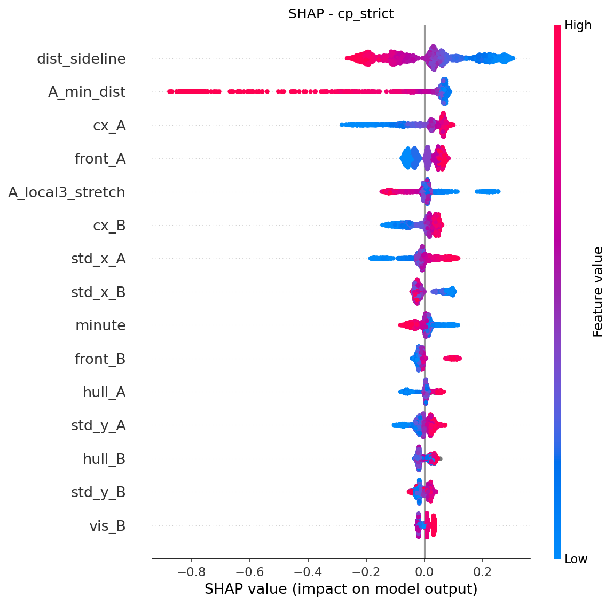

# Detecting counterpressing in football with StatsBomb data

Can a machine learning model spot **counterpressing** (pressing immediately after losing the ball) from public
data? This project adapts the method of [Bauer & Anzer (2021)](https://doi.org/10.1007/s10618-021-00763-7) to
StatsBomb's open event + 360 data for all **64 matches of the 2022 FIFA World Cup**, using XGBoost.

> **Short answer:** yes, a bit. On open-play turnovers the model ranks counterpressing situations consistently
> better than the paper's simple "a player within 5 yards" rule (ROC-AUC **0.60 vs 0.55**), but far below the
> paper's 0.87, because public data has no tracking and no expert labels. Most of the signal is simply *how close
> the team that lost the ball is to the ball*.


*Which features push the model toward "counterpress" (right) or away (left). Colour = feature value.*

## Key results

Nested, repeated cross-validation where **whole matches** are held out (3 repeats x 5 folds). Mean (std).

| Setting | Model | ROC-AUC | PR-AUC | MCC |
|---|---|---|---|---|
| All turnovers (n=2,823, base rate 0.50) | 5-yard rule (baseline) | 0.600 (0.011) | 0.562 | 0.214 |
| | XGBoost | 0.684 (0.017) | 0.639 | 0.299 |
| **Excluding goalkeeper wins (n=2,497, base rate 0.57)** | 5-yard rule (baseline) | 0.547 (0.015) | 0.590 | 0.107 |
| | **XGBoost** | **0.597 (0.017)** | **0.638** | **0.149** |

- **Why two rows?** 11.5% of turnovers are won by the goalkeeper and are almost never counterpressed (3.4% vs 56.5%).
  They are easy to classify and inflate the scores, so the second row is the more honest estimate.
- A second target, *"is the ball regained within 5 seconds?"*, is only weakly predictable (ROC-AUC 0.63, base rate 6%).
- Full tables, discussion and limitations: **[docs/writeup.md](docs/writeup.md)**. Raw numbers: [results/final_results.csv](results/final_results.csv).

## How it works

```
StatsBomb events + 360 frames
        |
        v
1. Find turnovers: possession changes between teams in open play, ball lost in the losing team's attacking half
        |
        v
2. Features (at the instant of the turnover): location, previous-possession context, players near the ball,
   numerical superiority, players ahead of / behind the ball, compactness, ...
        |
        v
3. Labels:  y_cp     = StatsBomb "counterpress" flag within 5 s   (proxy label, a provider's rule)
            y_regain = losing team has an on-ball action within 5 s
        |
        v
4. XGBoost (Optuna-tuned) vs. 5-yard baseline, grouped cross-validation by match, SHAP for interpretation
```

### How this differs from the paper
| | Bauer & Anzer (2021) | This project |
|---|---|---|
| Positional data | 25 Hz tracking of all 22 players | one 360 freeze-frame, visible players only |
| Labels | 11,108 turnovers hand-labelled by analysts | StatsBomb's `counterpress` flag |
| Data | Bundesliga, 97 labelled matches | World Cup 2022, 64 matches |
| Reported AUC | 0.874 | 0.597-0.684 |

## Quick start

Developed on Python 3.12; other recent Python 3 versions should work. Run everything from the repository root.

```bash
# 1. get the code
git clone https://github.com/mazenwld1/counterpressing-wc2022.git
cd counterpressing-wc2022

# 2. get the data (not included in this repo - see "Data & attribution")
git clone --depth 1 https://github.com/statsbomb/open-data.git open-data

# 3. install dependencies
python -m venv .venv
.venv\Scripts\activate          # Windows  (macOS/Linux: source .venv/bin/activate)
pip install -r requirements.txt

# 4. run
python counterpress_wc2022.py --quick     # ~minutes: 1 repeat, 5 tuning trials, to check everything works
python counterpress_wc2022.py             # full experiments (reproduces the table above; takes a while)
```

Useful options:

| Command | What it does |
|---|---|
| `--runs cp_strict` | run only one experiment (`cp`, `regain`, `cp_strict`, `regain_strict`) |
| `--data-dir PATH` | use StatsBomb data stored somewhere else |

The first run builds `counterpress_dataset.csv` (about a minute) and reuses it afterwards. **Delete it if you
change the feature or label code.** Outputs go to `results/`.

## Troubleshooting
| Problem | Fix |
|---|---|
| `No module named 'optuna'` (or xgboost, shap...) | Install into the *same* Python that runs the script: `python -m pip install -r requirements.txt`. In VS Code, check the interpreter with **Python: Select Interpreter**. |
| `module 'socketserver' has no attribute 'UnixStreamServer'` when importing `shap` (Windows) | A stray `pyspark` install breaks `shap`. Run `python -m pip uninstall pyspark`. The script now skips the SHAP figure with a warning instead of crashing. |
| `StatsBomb data not found` | `--data-dir` must point at the folder that contains `matches/`, `events/` and `three-sixty/`. |

## Repository layout

```
counterpress_wc2022.py   main pipeline: turnovers -> features -> labels -> CV -> SHAP
results/                 final_results.csv + SHAP figures from the reported run
docs/writeup.md          full write-up: method, results, discussion, limitations
diagnostics/             optional helper scripts used during development
requirements.txt
```

In `counterpress_wc2022.py`, read the functions in this order: `frame_feats` (360 features) ->
`match_turnovers` (turnovers + labels) -> `nested_cv` (evaluation) -> `run` (one experiment).

## Limitations (please read before quoting numbers)
- Labels are a data provider's rule, not expert judgement; the model measures agreement with that rule.
- Features come from a single snapshot with partial player visibility; no movement information.
- Small sample (64 matches, ~180 regains). Cross-validation folds overlap across repeats, so the reported
  standard deviations understate true uncertainty - treat differences as "consistent", not "significant".
- The regain results still include goalkeeper wins and are probably optimistic.

## Data & attribution
This repository does **not** contain StatsBomb data. The data comes from
[StatsBomb Open Data](https://github.com/statsbomb/open-data); StatsBomb asks that work based on it credits them
as the source - please read their license/user agreement in that repository before publishing anything derived from it.

## Reference
Bauer, P., & Anzer, G. (2021). Data-driven detection of counterpressing in professional football. *Data Mining and
Knowledge Discovery, 35*, 2009-2049. https://doi.org/10.1007/s10618-021-00763-7

## License
Code: MIT (see [LICENSE](LICENSE)). The StatsBomb data has its own terms.
